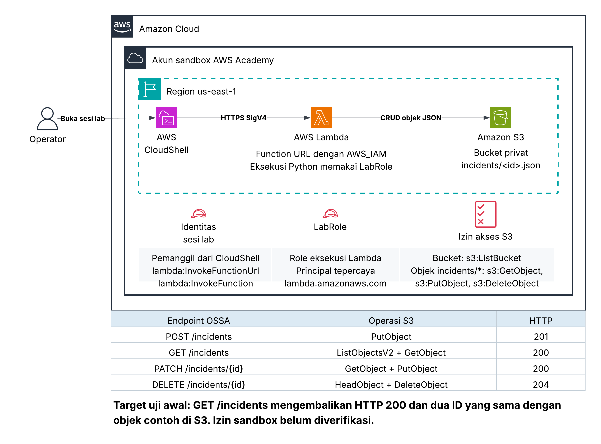

# OSSA | Corporate Security Incident Tracker

OSSA membantu tim keamanan mencatat dan menindaklanjuti insiden lintas departemen. Departemen dan kategori dipilih dari daftar yang dikelola admin. Analis menetapkan tingkat keparahan, penanggung jawab, dan status kasus.

## Arsitektur Track C

Operator memakai CloudShell untuk memanggil Lambda Function URL melalui HTTPS dengan SigV4. Identitas sesi memerlukan izin invoke. Lambda menggunakan execution role lab untuk membaca objek JSON dari prefix private S3 `incidents/`. Region rancangan adalah `us-east-1`.

## Kontrak API

| Endpoint | Fungsi | HTTP sukses | Tahap |
| --- | --- | --- | --- |
| GET /incidents | Daftar insiden dalam array items | 200 | Starter, diuji lokal |
| POST /incidents | Buat laporan | 201 | Rancangan |
| PATCH /incidents/{id} | Perbarui triase | 200 | Rancangan |
| DELETE /incidents/{id} | Hapus record uji | 204 | Rancangan |

## Menjalankan tes

Dari root repo, jalankan `python -m unittest discover -s tests -v` dengan Python 3.11 atau lebih baru. Tes memakai dua insiden fiktif dan tiruan klien S3 sehingga dapat dijalankan tanpa kredensial AWS.

## Demo lab

Target demo adalah HTTP 200 dengan dua ID yang sama seperti objek contoh di S3. Ikuti [panduan deployment](docs/deployment.md) saat sesi lab tersedia. Pengujian AWS masih tertunda. Perluasan EC2, ECR dan RDS MySQL direncanakan setelah demo Track C dan konfirmasi akses sandbox.
